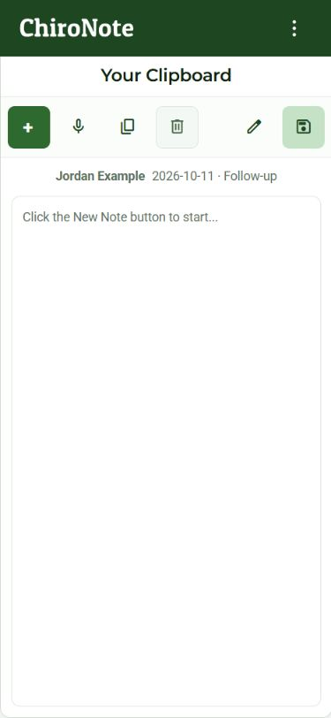
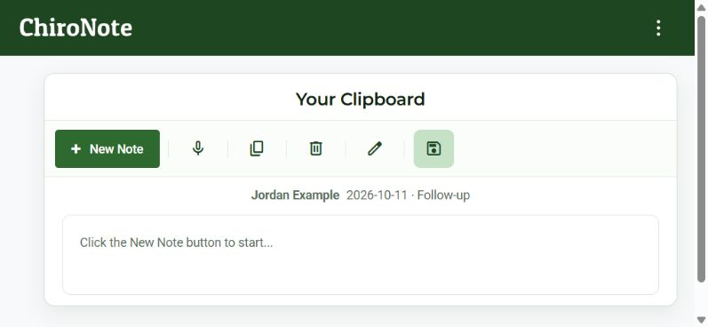

# Android phone Clipboard layout correction

Internal 32's phone screenshot showed Edit wrapping alone and an empty SOAP gutter. The correction uses a compact labeled New Note plus button, 48px phone actions, balanced empty-note gutters, and spaced patient/visit identity. SOAP notes retain their section rail.

Synthetic previews at 375x812,390x844,812x375 and1024x768 have all six actions visible in one row and no horizontal overflow. Production build with patient notes/capture enabled, MainWorkspace Jest (1 suite/3 tests), OKS (26 concepts) and whitespace checks passed. No recording, Save, clipboard adapter, auth, SDK or signing behavior changed.

These are isolated synthetic component previews, not native device acceptance. Source integration does not replace the currently published 32/1.32 app. OS keyboard, largest system text, safe areas and installed-device behavior remain separate checks.
