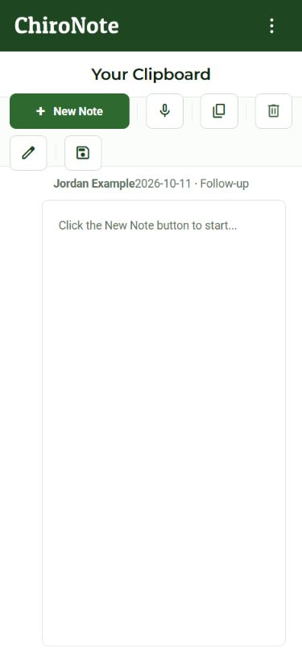

# Conditional iOS phone Clipboard layout correction

The owner requested iOS changes only if visual checks reproduced the Android regression. The unmodified 9552344 source, including ios.css and body.native-mobile, reproduced two toolbar rows and a 52px empty SOAP rail at375px. The correction uses compact labeled New Note, 48px phone actions, balanced writing gutters and spaced patient/visit identity. iOS's older textarea width calculation is overridden only on phones. SOAP notes retain their rail.

Synthetic native-style previews at375x812,390x844,812x375 and1024x768 have all actions visible in one row and no horizontal overflow. SOAP S/O/A/P controls appear with synthetic SOAP text; no browser errors were recorded. Production build with patient notes/capture enabled, MainWorkspace Jest (1 suite/3 tests), OKS and whitespace checks passed.

The standalone Android preview harness was copied locally for iOS comparison and is not imported by the production entrypoint. It and baseline inputs are preserved externally under C:/Users/nikit/Documents/Codex/2026-10-11/clipboard-layout/ios-review-harness. These browser previews do not certify physical iPhones, keyboard/safe areas, largest system text or dark mode. Source integration does not replace TestFlight1.8(9) already Testing.
