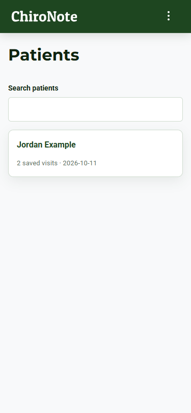
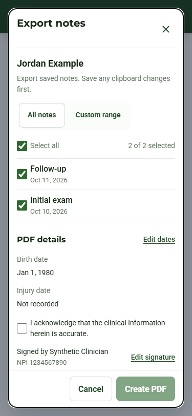
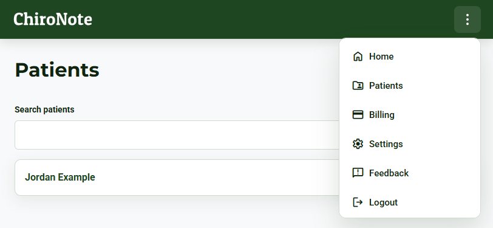
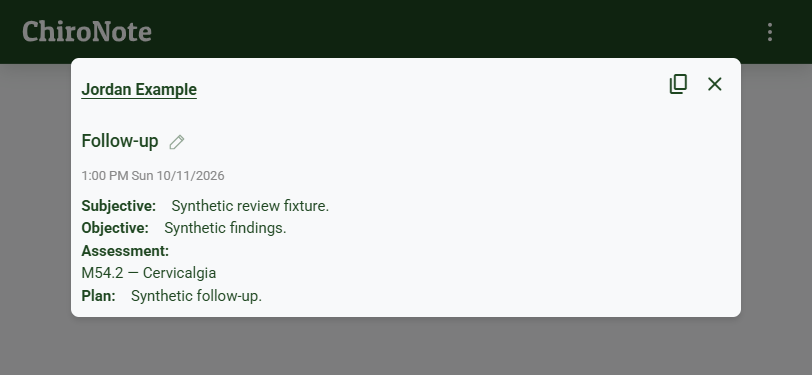

# Android patient workflow review — 2026-10-11

Selective parity with published-web source 142383e, based on cap-and 6537280. The source adds compact capture, patient management, one authoritative clipboard editor with native-phone Save, diagnosis/draft/conflict guards, and native cache/share PDF delivery. Existing native authentication, recording, clipboard and billing/analytics boundaries remain.

## Validation

- Standard CRA/Jest run: 37 suites / 147 tests passed.
- Production build, complete OKS validation (26 concepts), whitespace check and Android-only Capacitor sync passed. Existing lint and tool deprecation warnings remain.
- Gradle clean assembleDebug bundleRelease passed on JDK 21.0.10 / SDK 36. APK badging verifies com.chironote.app, code31/name1.31, min22/target36.
- Signed AAB: 27,825,561 bytes; SHA-256 8743FE92106A9558754C7B8CD08ECF5664F7D4575BAC2F1252F8620C226FE46B. Its signer matches the preserved version30 AAB. This candidate was not uploaded.
- Synthetic component previews: Patients, export, capture, clipboard and popup at 375×812 and 812×375, plus 125% text export sample and reduced motion. All 11 runs had zero horizontal overflow and no browser console/page errors. Edit/Save and landscape Logout were visible after responsive corrections.

The preview uses synthetic identities and mocked services; it is not a real account or device test. Checkbox labels are clickable beyond the 20px glyph; not every existing icon control has been independently certified against a touch-target standard. OS keyboard/safe areas, microphone/background recording, credential-provider behavior, clipboard, PDF sharing/cancellation and recipient/cache behavior remain installed-device acceptance gates. No backend or Play mutation occurred. Production/Internal version30 remains the separately observed store state.

## Representative screenshots

Reproduce the isolated preview with node scripts/mobile-workflow-preview.cjs and serve the ignored .mobile-preview folder. Never copy its output into the production build or native assets.
