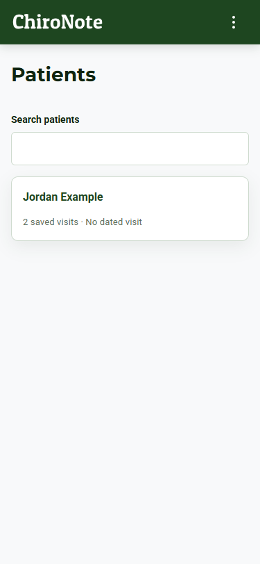
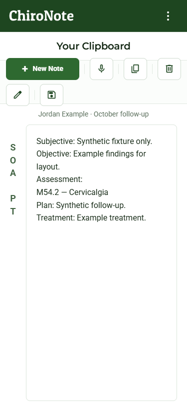
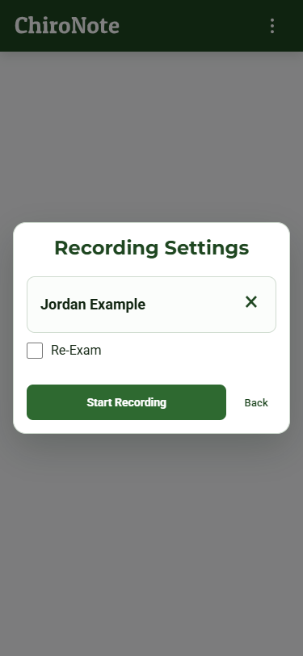
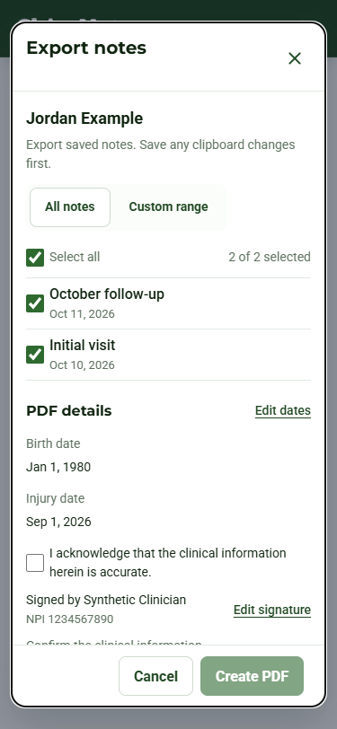
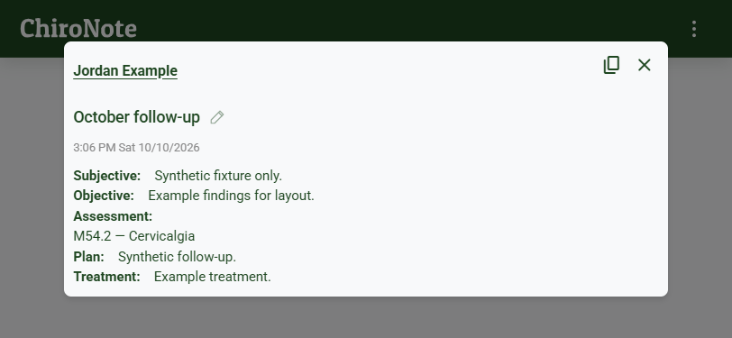
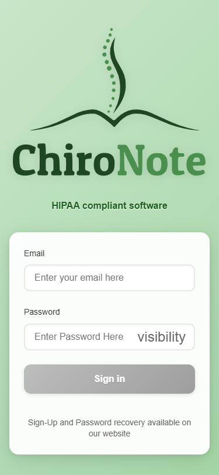

# iOS patient workflow review — 2026-10-11

Selective parity with published-web source 142383e, based on cap-ios 2326d34. Patients and saved history now use one versioned clipboard editor with native-phone Save, diagnosis/draft/conflict guards, compact capture, reassignment/deletion and native PDF sharing. Native Account/billing boundaries and WebKit recording transactions remain. Legacy plaintext password storage is removed and purged; standard autofill semantics remain, without claiming a native Keychain implementation.

## Validation

- Standard CRA/Jest run: 33 suites / 140 tests passed, including retained recording lifecycle, dictation insertion, auth and actual route-guard navigation. Router7.2's CJS-only test context limitation is documented in the route-guard regression; production ESM is unchanged.
- Production web build passed with existing lint/deprecation warnings. A subsequent CSS-only auth-card correction was rebuilt and checked in the browser; no test logic changed after the passing suite.
- Synthetic component previews: Patients, export, capture, clipboard and popup at 375×812 and 812×375, plus 125% text export sample and reduced motion. All 11 runs reported zero horizontal overflow and no browser console/page errors. Edit/Save and landscape Logout were visible.
- The actual production bundle opened /app in a fresh offline browser at both widths. Sign-in rendered without a router/page error or horizontal overflow. The landscape form is vertically scrollable. All nonlocal requests were blocked; only the expected font requests were attempted, and no account/backend request ran. The offline screenshot consequently shows fallback text for font icons.
- Static native inspection: privacy plist parses and is linked in Xcode resources; Filesystem FileTimestamp/C617.1 declaration is limited to app-container metadata. Share6.0.2 package/lock/podspec agree and accept installed Capacitor6.2.1.

[Subsequent Mac validation](mac-native-validation.md) resolved Share in CocoaPods and passed the unsigned Xcode simulator build, with the privacy manifest packaged. These checks do not establish device/signature acceptance. Signed archive, microphone/background, autofill, clipboard and PDF receiver/cancellation/cache checks remain pending. Verify the registered Apple identity before reconciling Capacitor com.chironote.app with Xcode ai.chironote.app; neither was changed. Nothing was submitted to Apple and no backend was changed.

## Representative screenshots

